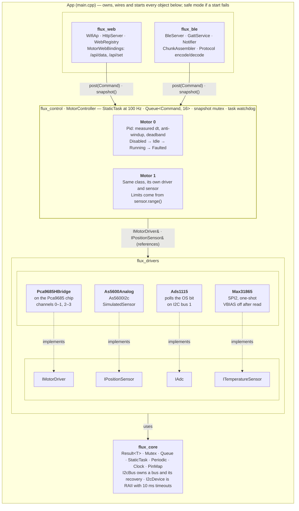

# Flux ESP App — C++ Migration Plan

As of 2026-10-26 · Status: **draft for review** · Source: [Claude Docs version](https://claude.ai/artifact/KU2krhyjEkDzGs1bazREHB)

- [Summary](#summary)
- [Roadmap](#roadmap)
- [Target architecture](#target-architecture)
- [Ground rules](#ground-rules)
- [Phase 0 — Foundation](#phase-0--foundation)
- [Phase 1 — Core utilities (flux_core)](#phase-1--core-utilities-flux_core)
- [Phase 2 — Device drivers (flux_drivers)](#phase-2--device-drivers-flux_drivers)
- [Phase 3 — Motor control (flux_control)](#phase-3--motor-control-flux_control)
- [Phase 4 — Web interface (flux_web)](#phase-4--web-interface-flux_web)
- [Phase 5 — BLE (flux_ble)](#phase-5--ble-flux_ble)
- [Phase 6 — App composition and cleanup (main)](#phase-6--app-composition-and-cleanup-main)
- [Recommendation mapping](#recommendation-mapping)
- [Risks and open questions](#risks-and-open-questions)

## Summary

The plan moves the firmware from C to C++ in seven phases, working from the bottom of the stack up. The firmware keeps building and running on hardware at the end of every phase. Each phase also fixes the findings in [RECOMMENDATIONS.md](RECOMMENDATIONS.md) that live in the code it touches, so nothing is ported twice. Rough total effort: about 3–4 weeks of focused work.

- **Why C++ here:** the code already uses C++ ideas built by hand. `motorIF_t`, `feedback_t` and `adcIF_t` are vtables, and `privCtx` stands in for `this`. C++ gives those patterns compiler checking, plus RAII for mutexes and I2C devices, `enum class`, `constexpr` pin maps and typed errors. None of those cost anything at runtime.
- **How:** C and C++ live side by side during the move. Each phase replaces one layer and leaves a thin C-compatible shim for the layer above. The shim is deleted in the phase that ports the code above it, and the last shim goes in Phase 6.
- **Structure change:** the single `main` component is split into ESP-IDF components (`flux_core`, `flux_drivers`, `flux_control`, `flux_web`, `flux_ble`). Each gets its own dependency list, and the pure-logic parts can be unit-tested on a PC.
- **What stays the same:** the hardware, the pinout, the HTTP keys the dashboard uses, the BLE UUIDs and the JSON protocol. The only deliberate breaking change is that `/set` moves to `POST` in Phase 4, and the dashboard changes with it.
- **Before Phase 0:** I recommend fixing five critical items in the current C code first (C1, C2, C5, C6, R2). Each is a few lines, and the migration takes weeks, so it is worth having safe firmware on the bench while it happens.

The review questions are in the last section.

## Roadmap

```mermaid
flowchart LR
    H["Hotfix in C<br/><small>optional · C1 C2 C5 C6 R2<br/>about half a day</small>"]:::optional
    P0["Phase 0 · Foundation<br/><small>Kconfig, CI, layout<br/>1–2 days</small>"]
    P1["Phase 1 · Core utilities<br/><small>Result, RTOS, I2C<br/>about 2 days</small>"]
    P2["Phase 2 · Device drivers<br/><small>Drivers + C bridge<br/>3–4 days</small>"]
    P3["Phase 3 · Motor control<br/><small>PID, queue, watchdog<br/>3–4 days</small>"]
    P4["Phase 4 · Web interface<br/><small>POST API + token<br/>2–3 days</small>"]
    P5["Phase 5 · BLE<br/><small>Framing + bonding<br/>3–4 days</small>"]
    P6["Phase 6 · Composition<br/><small>Safe mode + cleanup<br/>1–2 days</small>"]

    H -.-> P0
    P0 -- gate --> P1 -- gate --> P2 -- gate --> P3 -- gate --> P4 -- gate --> P5 -- gate --> P6

    classDef optional stroke-dasharray: 4 4
```



**Gate** = the firmware builds with `-Werror`, host tests pass in CI, and the bench checklist is ticked. Efforts are rough estimates, about 3–4 weeks in total.

Each phase ships working firmware and passes its gate before the next one starts, so the work can pause after any phase without leaving the device broken.

## Target architecture



`MotorController` is the only code that changes motor state. Web and BLE handlers copy a command into its queue and read back a snapshot, which removes today's unlocked writes from the HTTP task. `As5600Analog` reads its voltage through `IAdc`, so it works with any ADC. Every component builds and tests on its own.

## Ground rules

These rules apply to every phase. They keep the C++ as cheap at runtime as the C it replaces. ESP-IDF v5.5 compiles C++ with GCC 14.2 as `gnu++2b` (C++23), with exceptions and RTTI turned off by default.

| Topic | Rule |
| --- | --- |
| Language level | C++23 as IDF ships it. `std::expected`, `std::span`, `std::array`, `std::string_view`, `std::optional`, `std::variant`, `constexpr` and `enum class` are all fine to use. |
| Exceptions and RTTI | Keep both off (`CONFIG_COMPILER_CXX_EXCEPTIONS=n`, `CONFIG_COMPILER_CXX_RTTI=n`). Never call code that can throw. For example, use `std::get_if`, not `std::get`, on variants. |
| Errors | Every fallible call returns `flux::Result<T>`, an alias for `std::expected<T, flux::Err>`. `flux::Err` is a small `enum class` (Io, Timeout, InvalidArg, Range, NotFound, NoMem, State). A helper converts `esp_err_t` into it. No `RESP_ERR`, and no silently ignored return codes: `Result` is `[[nodiscard]]`. |
| Memory | Allocate at boot, never in the control path. Objects live as members of one statically allocated `App`. Tasks, queues and mutexes use the `...Static` FreeRTOS calls. No `new`, `std::string`, `std::vector` or `std::function` in drivers or control code; web and BLE may use fixed `std::array` buffers. |
| Ownership | RAII everywhere. `I2cBus` owns a bus handle, `I2cDevice` owns a device handle, and `LockGuard` holds a mutex. Drivers take references to the bus they use and never delete it (fixes R9). |
| C interop | ESP-IDF, NimBLE and httpd callbacks go through `static` member functions that cast `void* arg` back to `this`. `app_main` is `extern "C"`. While both languages coexist, every C header that C++ includes gets `extern "C"` guards. |
| Logging | Each file has `static constexpr const char* TAG` and uses `ESP_LOGx` directly. Verbosity is set per tag with `esp_log_level_set()` or menuconfig. The `DBG_*` bitmask goes away (fixes A5). |
| Naming | Namespace `flux`. Types are `PascalCase`, functions and variables `camelCase` (as today), and members end in `_`. Constants are `kPascalCase`. Files are `PascalCase.hpp/.cpp`, one class per pair. |
| Interfaces | Pure abstract classes (`IMotorDriver`, `IPositionSensor`, `IAdc`, `ITemperatureSensor`) with a virtual destructor. Concrete classes are `final`. |
| Concurrency | One owner per piece of state. Other tasks send commands through a queue and read state through a snapshot copied under a mutex. No shared mutable globals. |
| Warnings | Each component builds with `-Wall -Wextra -Werror` from the phase that creates it (fixes B7). |
| Formatting | One `.clang-format` (4-space indent, 100 columns) added in Phase 0. It is applied only to files as they are ported, so the diff of each phase stays readable. |

## Phase 0 — Foundation

**Goal:** set up a project layout that builds C and C++ side by side, with secrets in Kconfig, CI on every push, and a host test harness. No behaviour changes. About 1–2 days.

**Target layout**

```text
flux_esp_application/
├── CMakeLists.txt
├── main/                     app composition only (by Phase 6)
│   ├── Kconfig.projbuild     Wi-Fi + BLE credentials, motor count, log defaults
│   └── main.c (C until Phase 6, then main.cpp)
├── components/
│   ├── flux_core/            Result, RTOS wrappers, I2C bus     (Phase 1)
│   ├── flux_drivers/         interfaces + device drivers        (Phase 2)
│   ├── flux_control/         PID, Motor, MotorController        (Phase 3)
│   ├── flux_web/             Wi-Fi AP, HTTP, dashboard          (Phase 4)
│   └── flux_ble/             GATT, framing, protocol            (Phase 5)
└── test/host/                Unity tests on the IDF linux target
```

**Steps**

1. Add `extern "C"` guards to every header in `main/` so C++ files can include them. Add an include guard to `loggingDefs.h` (part of A5).
2. Create `components/flux_core` with one C++ file, `BuildInfo.cpp`, which logs the firmware and IDF versions at boot. Call it from `main.c` through an `extern "C"` function. This proves the C++ toolchain, the component wiring and C-to-C++ calls. `main.c` itself stays C until Phase 6, because it relies on array designators (`[MOTOR_1] = {...}`) that C++ does not accept.
3. Replace `configEnv.h` with `main/Kconfig.projbuild`: `FLUX_AP_SSID`, `FLUX_AP_PASSWORD`, `FLUX_STA_SSID`, `FLUX_STA_PASSWORD`. Keep the real values in an uncommitted `sdkconfig.defaults.local`, and commit `sdkconfig.defaults.local.example`. Delete the `../../` include path and the unused `DEBUG` and `USE_DUMMY_FB` macros (B1, S1).
4. Trim `REQUIRES` to what is used (B3). Delete `sdkconfig.defaults.mini` and `.dram_optimised`, or move them to `profiles/` with a README (B4). Gitignore `dependencies.lock` (B2).
5. Add `.clang-format` and `.editorconfig`.
6. Add `.github/workflows/build.yml`. It uses `espressif/esp-idf-ci-action@v1` with IDF v5.5 to run `idf.py build` for `esp32`, then the host tests (B8).
7. Create `test/host/` as a separate IDF project with `set-target linux`. It holds one passing placeholder test, so the harness is proven before there is code to test.

**Exit gate**

- [ ] A fresh clone builds with only `sdkconfig.defaults.local` added.
- [ ] CI is green: firmware build plus host tests.
- [ ] On hardware the device behaves exactly as before: dashboard, open loop, position mode, BLE advertising.

## Phase 1 — Core utilities (`flux_core`)

**Goal:** build the small, header-mostly toolkit that every later phase uses. Nothing in the running firmware calls it yet, so the risk is low. About 2 days.

| New file | Replaces | What it gives |
| --- | --- | --- |
| `Result.hpp` | `resp_t`, `CHECK_PTR_*`, `RETURN_*_IF_ERR*` in `mainDefs.h` | `Result<T>` = `std::expected<T, Err>`, `toErr(esp_err_t)`, and a `TRY(expr)` macro that returns early on error |
| `Mutex.hpp` | Raw `SemaphoreHandle_t` + `xSemaphoreTake/Give` | Static mutex satisfying *BasicLockable*, so `std::lock_guard` and `std::unique_lock` work. `tryLockFor(ms)` returns `bool` |
| `Queue.hpp` | — | `Queue<T, N>` over `xQueueCreateStatic`. `static_assert(std::is_trivially_copyable_v<T>)` |
| `Task.hpp` | `xTaskCreate` calls | `StaticTask<StackWords>`: name, priority, core, and a member function to run. Optional watchdog subscription (used in Phase 3 for C6) |
| `Periodic.hpp` | `xSemaphoreTake(ctrlTaskSem, 8 ms)` | A fixed-rate pacer over `vTaskDelayUntil`. It reports the measured `dt` and whether a deadline was missed (used in Phase 3 for R1) |
| `Clock.hpp` | Direct `esp_timer_get_time()` | `Micros now()` returning a strong type, so µs and ms can't be mixed up (A7) |
| `I2cBus.hpp/.cpp` | Bus setup in `main.c`, `pca9685RecoverBus()`, `as5600RecoverBus()` | Owns `i2c_master_bus_handle_t`. Has a bus mutex, one `recover()` path, and a counter of consecutive failures |
| `I2cDevice.hpp/.cpp` | `i2c_master_bus_add_device` + `probe` in every driver | RAII device handle. `writeReg8/16`, `readReg8/16` and `readBurst` with a per-device timeout that defaults to 10 ms (R11). On failure it calls `bus.recover()` |
| `PinMap.hpp` | Pin `#define`s spread over three files | `constexpr` checks that no GPIO is assigned twice, using `static_assert` (R14) |

**Example: what a driver call looks like after this phase**

```cpp
flux::Result<uint16_t> Ads1115::readConversion() {
    TRY(dev_.writeReg16(kRegConfig, configWord(channel_)));
    TRY(waitForConversion());               // polls the OS bit, no fixed sleep (R10)
    return dev_.readReg16(kRegConversion);  // Result<uint16_t> passes straight through
}
```

**Tests (host):** `Result` and `TRY` propagation, `PinMap` duplicate detection (a negative-compile test), and `Queue` capacity. `I2cDevice` is tested in Phase 2 against a fake bus.

**Exit gate**

- [ ] `flux_core` builds with `-Werror` and has host tests in CI.
- [ ] The firmware binary size is unchanged within about 1 KB, because nothing links the new code yet.

## Phase 2 — Device drivers (`flux_drivers`)

**Goal:** replace the C interfaces and every driver with C++ classes. The C control loop keeps working through a temporary bridge. About 3–4 days.

**Interfaces**

```cpp
namespace flux {
struct Range { float min; float max; bool wraps; };   // e.g. {0, 360, true} for an AS5600

class IMotorDriver {
public:
    virtual ~IMotorDriver() = default;
    virtual Result<void> setDrive(float duty) = 0;   // -1..+1, sign = direction, rejects NaN
    virtual Result<void> enable()  = 0;
    virtual Result<void> disable() = 0;              // guarantees outputs off
};

class IPositionSensor {
public:
    virtual ~IPositionSensor() = default;
    virtual Result<float> readDegrees() = 0;         // Err::Range when the raw value is invalid (C4)
    virtual Range range() const = 0;                 // drives the motor limits (C3)
    virtual void  setZero(float offsetDeg) = 0;      // replaces the resetData stub
};

class IAdc {
public:
    virtual ~IAdc() = default;
    virtual Result<float> readVolts(uint8_t channel) = 0;
};

class ITemperatureSensor {
public:
    virtual ~ITemperatureSensor() = default;
    virtual Result<float> readCelsius() = 0;
};
}
```

**Driver by driver**

| From (C) | To (C++) | Implements | Fixed on the way |
| --- | --- | --- | --- |
| `pca9685.c` | `Pca9685` (chip) | — | Never deletes the bus (R9). Uses the full-OFF bit for a guaranteed 0 % duty. Writes both channels of a motor in one auto-increment burst, so there's no moment when both are high |
| `motorDriver_PCA9685.c` | `Pca9685HBridge` | `IMotorDriver` | `disable()` really turns outputs off (R5). Rejects non-finite duty (R3) |
| `ads1115.c` | `Ads1115` | `IAdc` | Polls the OS bit instead of sleeping 2× the conversion time (R10). Recovers the bus. Drops the dead alert code and unused `vRef`/`rRef` |
| `as5600.c` (I2C path) | `As5600I2c` | `IPositionSensor` | 10 ms timeout, not 1000 ms (R11). Returns `Err::Range` on invalid raw data |
| `as5600.c` (ADC path) | `As5600Analog` (takes an `IAdc&`) | `IPositionSensor` | Rejects voltages outside 0–VDD instead of returning -1° as a valid reading (C4) |
| `dummyFb.c` | `SimulatedSensor` | `IPositionSensor` | Types match, no divide by zero, no leaks (R16). Optionally follows the commanded drive, so position mode can be tested with no hardware |
| `max31865.c` | `Max31865` | `ITemperatureSensor` | Turns VBIAS off after each read (R12). Normalises the sub-zero polynomial (R13). Removes the SPI device if init fails |
| `motorDriver_L293D.*` | Deleted | — | A6. It can come back later as `L293dHBridge` on MCPWM if that hardware returns (see open questions) |

**Temporary bridge:** `LegacyBoard.cpp` exposes `extern "C" flux_board_init()`. That function owns the `I2cBus` objects and the drivers, and hands `main.c` C `motorIF_t` and `feedback_t` structs whose function pointers call the C++ objects. `motorCtrl.c` is unchanged in this phase. The bridge is deleted in Phase 3.

**Tests (host):** each driver against a `FakeI2cDevice` that records register writes and replays responses. Cases cover the PCA9685 init sequence and channel bytes, the ADS1115 config word for each channel and PGA, the AS5600 12-bit masking and range errors, and the MAX31865 temperature curve at -50, 0, 100 and 300 °C.

**Exit gate**

- [ ] All six driver classes have host tests that pass.
- [ ] On hardware: open loop works in both directions, position mode reaches 90° and 270°, and unplugging the AS5600 latches `STATE_FAILED` within 5 cycles.
- [ ] The `verbLogs` loop time drops by about 5 ms, because of the faster ADS1115 read.

## Phase 3 — Motor control (`flux_control`)

**Goal:** replace `motorCtrl.c` with three classes. The control task becomes the only owner of motor state. Everything else talks to it through a command queue and reads it through snapshots. This phase fixes the most findings. About 3–4 days.

| Class | Responsibility | Fixes |
| --- | --- | --- |
| `Pid` | Pure maths, no RTOS, fully host-testable. Takes the measured `dt`, uses `fabsf`, clamps the integral (anti-windup), puts the derivative on the measurement, and rejects NaN/Inf | R1, R2, R3, R4 |
| `Motor` | Holds one `IMotorDriver&`, one `IPositionSensor&`, a `Pid`, its mode, setpoints, limits and fault latch. Its `step(dt)` does read → compute → drive. Limits come from `sensor.range()`, with the shortest-path error on wrapping sensors. A stall detector latches `Faulted` when the error doesn't shrink for N seconds | C2, C3, R5, R7, R29 |
| `MotorController` | Owns the `Motor` array, the `StaticTask`, the `Periodic` pacer, the `Queue<Command, 16>` and the snapshot mutex. Subscribes to the task watchdog and feeds it once per cycle | C6, R1, R6, R8, A2, A3 |

**State machine (per motor):** `Disabled → Idle → Running → Faulted`. The requested mode is kept while disabled, and only the output is gated (R29). Leaving `Faulted` needs `enable()` *and* a good sensor read plus a good drive write (R5). While faulted, the motor does no I/O except one recovery probe per second (R7).

**Public API**

```cpp
namespace flux {
enum class Mode : uint8_t { Off, Position, OpenLoop };

struct Gains { float kp, ki, kd, minOut, maxOut, deadband; };

using Command = std::variant<
    cmd::Enable,       // { uint8_t motor; bool on; }
    cmd::SetMode,      // { uint8_t motor; Mode mode; }        validated before it is queued (C2)
    cmd::SetDuty,      // { uint8_t motor; float duty; }       finite, clamped to -1..1
    cmd::SetTarget,    // { uint8_t motor; float degrees; }    finite, clamped to range()
    cmd::SetGains>;    // { uint8_t motor; Gains gains; }      all six fields required (R26)

struct MotorSnapshot {
    float position, target, duty, error, integral;
    Mode mode; MotorState state; bool enabled; Gains gains;
};

class MotorController {
public:
    Result<void>  start();                                  // task + watchdog
    Result<void>  post(const Command& c, uint32_t waitMs = 10);
    MotorSnapshot snapshot(uint8_t motor) const;            // copy taken under the mutex
    LoopStats     stats() const;                            // period, jitter, deadline misses
};
}
```

**Loop timing:** the pacer runs at 100 Hz (10 ms), set by Kconfig `FLUX_CTRL_PERIOD_MS`. The PID uses the measured `dt`. `LoopStats` replaces the `verbLogs` metrics and is shown on the dashboard. A missed deadline is counted, not ignored.

**Temporary C facade:** `MotorApi.cpp` keeps the existing C functions (`setMotorEnable`, `setDriveMode`, `setTargetPwm`, `setTargetPos`, `setLoopGains`) as `extern "C"` wrappers that call `post()`. It also adds `motorApiGetSnapshot(idx, &snap)`, which fills a plain C struct. `mtrWebBindings.c` swaps its direct `motorCtx_t` reads for snapshot reads (a small mechanical change), and the BLE code doesn't change. The `LegacyBoard` bridge from Phase 2 is deleted.

**Tests (host):** `Pid` step response and windup against a simulated first-order motor, deadband, and NaN rejection. `Motor` with fake driver and sensor: limit clamping, wrap-around error, fault latch after 5 failures, recovery, stall detection, and the mode kept while disabled. `Command` validation rejects mode 7, NaN and short gain lists.

**Exit gate**

- [ ] Host tests pass, with `Pid` and `Motor` line coverage above 90 %.
- [ ] On hardware: the loop period is 10 ms ± 1 ms with zero deadline misses over 10 minutes, and a 0→180° move settles without overshooting past the deadband.
- [ ] Fault injection: unplugging the sensor latches `Faulted` within 5 cycles, and stopping the control task in a debugger triggers a watchdog reboot that comes back up with outputs off.

## Phase 4 — Web interface (`flux_web`)

**Goal:** port Wi-Fi, the HTTP server and the dashboard bindings to C++, close the web security gaps, and drop the C motor facade's setters. About 2–3 days.

| From (C) | To (C++) | Fixed on the way |
| --- | --- | --- |
| `wifiSetup.c` | `WifiAp` | Credentials come from Kconfig. The default AP password is derived per device from the MAC address and printed at boot and on the serial console (S1). Init errors return `Result` instead of aborting (R28). No STA netif until STA mode exists |
| `webApp.c` | `HttpServer` + `WebRegistry` | Per-request fixed buffers sized from the request, so the C1 overflow class can't exist. Each JSON chunk is bounded (R25). Routes are registered through `static` trampolines |
| `mtrWebBindings.c` | `MotorWebBindings` | Reads `MotorController::snapshot()` and writes through `post()`. `sys.verbLogs` and `sys.loopStats` are registered once (R27) |
| `index.html`, `style.css` | Same files, moved to `flux_web/www/` | Uses `textContent` instead of `innerHTML` (S4). Calls `POST /api/set` with a JSON body and a token header. Shows the new `state` names and the loop stats |

**API change (the only intentional break)**

| Old | New |
| --- | --- |
| `GET /set?key=mtr0.mode&val=1` | `POST /api/set` with body `{"key":"mtr0.mode","val":1}` and header `X-Flux-Token: <token>` |
| `GET /data` | `GET /api/data` (same JSON shape). `/data` stays as a read-only alias for one release |
| — | `GET /api/token`, answered only on the first request after boot, or after a long press on a button (open question) |

The token stops other browser tabs from sending commands across sites (S2). It is not strong authentication; pairing the app over BLE is the long-term answer.

**Registry without heap:** the registry has fixed capacity: `std::array<Field, 48>`, where each `Field` is `{ std::string_view key; FieldKind kind; Getter get; Setter set; void* ctx; }`. Keys are `constexpr` strings built per motor at compile time. A registration that doesn't fit is a compile-time error, not a log line.

**Tests (host):** request parsing with oversize, missing, malformed and percent-encoded bodies. A fuzz corpus over the `/api/set` parser (it would have caught C1). Gains parsing requires all six values. On target: a `pytest-embedded` smoke test of `/api/data` and `/api/set`.

**Exit gate**

- [ ] Fuzzing for 10 minutes finds no crash and no ASan report on the host build.
- [ ] The dashboard works end to end on a phone and a laptop. A `curl` with no token gets `401`.
- [ ] The C facade setters are deleted. Only the snapshot getter remains, for BLE until Phase 5.

## Phase 5 — BLE (`flux_ble`)

**Goal:** port the NimBLE service to C++, split the pure protocol logic out where it can be tested, and secure the link. The UUIDs and the JSON message shapes stay the same, so the mobile app keeps working. About 3–4 days, plus time to update the mobile app for bonding.

| From (C) | To (C++) | Fixed on the way |
| --- | --- | --- |
| `fluxBleService.c` | `BleServer` | GAP events through a `static` trampoline. Puts the 128-bit service UUID in the scan response (R23). Clears subscription state on disconnect (R22). `start()` returns `Result` (A9) |
| `gattSvr.c` | `GattService` | No `assert` on paths a peer can reach; returns ATT errors instead (R21). The write characteristics are marked `WRITE_ENC`, with LE Secure Connections and bonding (S3). Receive length is bounded at `kRxMax - 1` (R19) |
| `blePacketHandler.c` (framing) | `ChunkAssembler` | Pure class with no NimBLE dependency. Validates the header strictly (C5). Bounds the total size. Times out after 2 s between chunks (R24) |
| `blePacketHandler.c` (JSON) | `ProtocolDecoder` | Decodes cJSON into typed `std::variant<RecipeLoad, StepAdvance, Abort, SettingsUpdate>`, with no log-format bugs (R18). Unknown or invalid input returns `Err::InvalidArg` |
| `bleNotifyPackets.c` | `ProtocolEncoder` + `Notifier` | Builds JSON into a bounded writer, with escaping and truncation checks (R17). Chunks outgoing messages to the negotiated MTU − 3 (R30). Sends through `ble_gatts_notify_custom()` with an mbuf, under a mutex, instead of the shared `tx_buf` (R20) |
| `protocolTypes.h` | `Protocol.hpp` | `enum class` and `std::array` instead of plain enums and counts, plus `constexpr` limits |

**Where decoded messages go:** `RecipeLoad`, `StepAdvance` and `Abort` are handed to a `RecipeSink` interface. In this phase the sink logs them, which matches today's behaviour. A real `RecipeExecutor` is new feature work, not part of the migration (see open questions). `Abort` with `safeState: true` posts `Enable{off}` for every motor right away. That is the one behaviour this phase adds, because it is a safety path.

**Tests (host):** `ChunkAssembler` covers a missing `|`, out-of-order chunks, duplicate chunks, overflow, timeout and a 4 KB message. `ProtocolDecoder` and `ProtocolEncoder` round-trip every message type, including strings that need escaping and a telemetry message that needs splitting. A fuzz corpus is fed to both.

**Exit gate**

- [ ] The mobile app pairs, bonds, uploads a 20-step recipe in chunks, and receives a telemetry notification that splits across chunks.
- [ ] An unbonded phone can read the device but its writes are rejected.
- [ ] The C motor facade is deleted completely.

## Phase 6 — App composition and cleanup (`main`)

**Goal:** `main` becomes a short composition root: construct objects, wire them, and start them. All C code, bridges and dead files are gone. About 1–2 days.

**`BoardConfig.hpp`** holds every pin, bus, address, channel and default gain as `constexpr` data, checked by `PinMap` (A1, R14):

```cpp
namespace flux::board {
inline constexpr I2cBusConfig kBus0{ .port = 0, .sda = 15, .scl = 17, .hz = 100'000 };
inline constexpr I2cBusConfig kBus1{ .port = 1, .sda = 32, .scl = 33, .hz = 100'000 };
inline constexpr uint8_t kPcaAddr = 0x40, kAdsAddr = 0x48;
inline constexpr std::array kMotors{
    MotorConfig{ .chPos = 0, .chNeg = 1, .gains = {0.01f, 0.01f, 0.f, -0.4f, 0.4f, 1.f} },
    MotorConfig{ .chPos = 2, .chNeg = 3, .gains = {0.01f, 0.f,   0.f, -0.4f, 0.4f, 2.f} },
};
static_assert(PinMap{kBus0, kBus1, kSpiRtd}.unique());
}
```

**`App`** owns everything, in construction order. It is one `static` instance in `main.cpp`:

```cpp
class App {
    I2cBus bus0_{board::kBus0}, bus1_{board::kBus1};
    Pca9685 pca_{bus0_, board::kPcaAddr};
    Ads1115 ads_{bus1_, board::kAdsAddr};
    Pca9685HBridge drv0_{pca_, 0, 1}, drv1_{pca_, 2, 3};
    As5600Analog enc0_{ads_, Ads1115::Mux::A0_A1};
    SimulatedSensor enc1_{};
    MotorController motors_{{Motor{drv0_, enc0_, ...}, Motor{drv1_, enc1_, ...}}};
    WifiAp wifi_; HttpServer http_; MotorWebBindings webBindings_{http_, motors_};
    BleServer ble_{motors_};
public:
    Result<void> start();   // init order + safe mode on failure
};

extern "C" void app_main() { static App app; if (!app.start()) app.enterSafeMode(); }
```

**Safe mode (A9):** if any init step fails, all PWM outputs are forced off, the motors stay disabled, and BLE and HTTP still come up if they can, so the failure can be read remotely. The on-board LED blinks an error code and the reason is logged. The board never sits silently half-initialised.

**Cleanup list**

- [ ] Delete `mainDefs.h`, `loggingDefs.h`, every `.c` file under `main/`, `testTask`, the `#if 0` blocks and `motorDriver_L293D.*` (A6).
- [ ] Replace the SPDX example headers with the project licence header and add `LICENSE` (A10).
- [ ] Add release and debug profiles: `sdkconfig.defaults.release` with `-Os` and INFO-level logs (B6).
- [ ] Write a two-slot OTA partition table for 4 MB flash, or record the decision to stay on 2 MB (B5).
- [ ] Rewrite the three README files for the new structure, and mark every item in `RECOMMENDATIONS.md` as resolved or deferred.

**Exit gate**

- [ ] No `.c` files remain under `main/` or `components/flux_*/` (`find main components -name '*.c'` prints nothing).
- [ ] The full hardware checklist passes: open loop, position, fault injection, watchdog, web, and BLE recipe upload.
- [ ] The image size is the same as or smaller than the C build of the same configuration.

## Recommendation mapping

All 59 findings in [RECOMMENDATIONS.md](RECOMMENDATIONS.md) have a home in the plan. The IDs match that file. A finding listed under two phases is started in the first and finished in the second.

| Phase | Findings resolved |
| --- | --- |
| Hotfix in C (optional, before Phase 0) | C1, C2, C5, C6, R2. These are re-done properly in Phases 3–5 |
| 0 — Foundation | B1, B2, B3, B4, B8, S1 (secrets out of source), A5 (include guard) |
| 1 — Core utilities | R11 (default I2C timeouts), R14 (`PinMap`), A7 (`Clock` types) |
| 2 — Device drivers | C4, R9, R10, R11, R12, R13, R15 (fit pull-ups during bench work), R16, A6 (L293D), A8 |
| 3 — Motor control | C2, C3, C6, R1, R2, R3, R4, R5, R6, R7, R8, R29, A2, A3, A7 |
| 4 — Web interface | C1, R25, R26, R27, R28, S1 (per-device AP password), S2, S4 |
| 5 — BLE | C5, R17, R18, R19, R20, R21, R22, R23, R24, R30, S3, A9 (BLE start status) |
| 6 — Composition and cleanup | A1, A5 (`DBG_*` removed), A6 (remaining dead code), A9 (safe mode), A10, B5, B6 |
| Every phase | A4 (each ported module has no exported globals), A11 (resolved by the migration itself), B7 (`-Werror` per component) |

## Risks and open questions

### Decisions needed before Phase 0

- [ ] **Hotfix first?** Should I fix C1, C2, C5, C6 and R2 in the current C code before starting (about half a day)? Recommended: yes.
- [ ] **Components or folders?** Splitting into five IDF components gives dependency checking and per-component tests, at the cost of more `CMakeLists.txt` files. The alternative is C++ folders inside `main`. Recommended: components.
- [ ] **Branch strategy:** one long-lived `feature/cpp-migration` branch with a PR per phase, or merge each phase to `main`? Recommended: a PR per phase into `main`, since every phase ends with working firmware.
- [ ] **L293D driver:** delete it, or port it as `L293dHBridge` in Phase 2? Recommended: delete, unless that board is still in use.
- [ ] **Control rate:** keep the 125 Hz target (needs the ADS1115 in continuous mode at 475+ SPS), or settle on 100 Hz? Recommended: 100 Hz, measured, and configurable.

### Decisions needed later

- [ ] **Phase 4 token:** how does the dashboard get its token (first request after boot, a button press, or shown on the serial console)? This depends on the physical UI.
- [ ] **Phase 5 bonding:** the mobile app has to handle pairing prompts. Who updates the app, and is that in scope?
- [ ] **Recipe executor:** the plan only routes decoded recipe messages to a `RecipeSink`. Is building the executor (valves, temperature targets, step timing) a separate project, or a Phase 7?
- [ ] **Flash size:** move to a 4 MB module for OTA (B5), or stay on 2 MB with no OTA?

### Risks

| Risk | Likelihood | Mitigation |
| --- | --- | --- |
| C++ grows the image past the 1.5 MB partition | Medium | Keep exceptions and RTTI off. Avoid `<iostream>` and `<regex>`. Track the size in CI with `idf.py size`, and fail the build on a jump of more than 20 KB |
| `std::expected` or `std::variant` behaves differently with `-fno-exceptions` | Low | Use only `has_value()`, `operator*` and `std::get_if`. Add a host test that compiles with `-fno-exceptions` |
| NimBLE or httpd callbacks run in other tasks and race the C++ objects | Medium | All state changes go through `MotorController::post()`. Callbacks only copy data and queue it. Phase 3 code review checks that |
| The bridges and facades linger after their phase | Medium | Each one is deleted in a named phase and checked in that phase's exit gate |
| Hardware tests are skipped because the host tests pass | Medium | Each exit gate has a hardware checklist. A phase is not done until someone ticks it on the bench |
| The mobile app breaks because of the BLE security change | High if not coordinated | Gate `WRITE_ENC` behind Kconfig `FLUX_BLE_REQUIRE_BONDING` (default off) until the app supports it |
