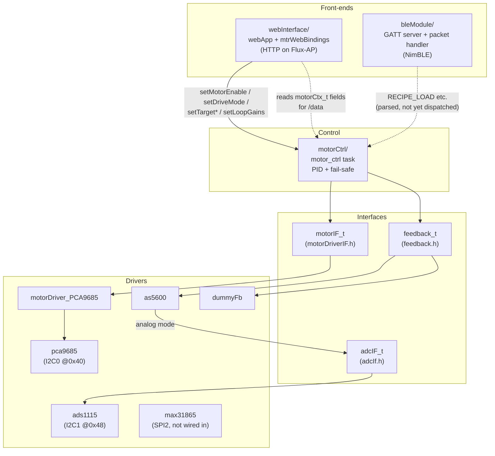
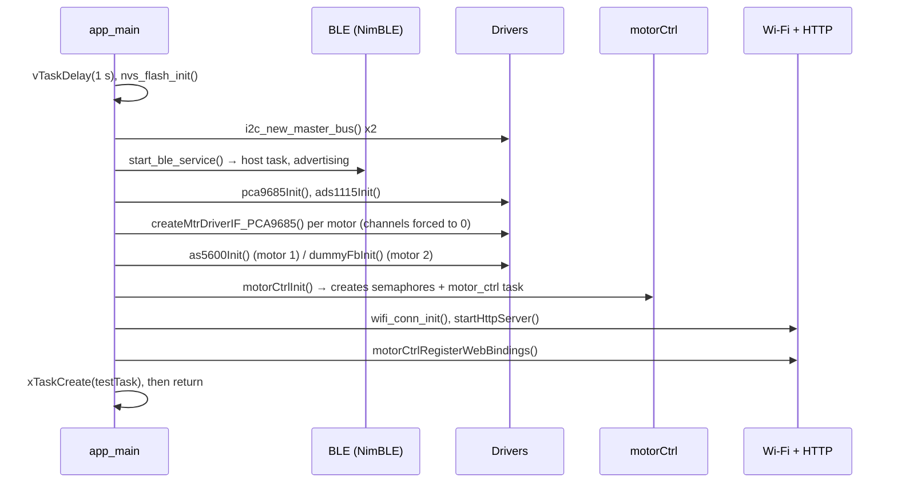
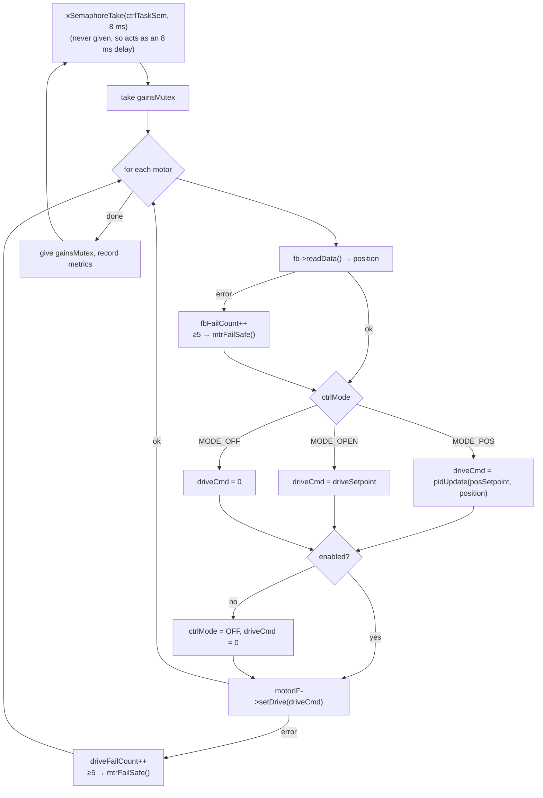

# Firmware architecture

This file explains how the `main` component is put together: the modules, the tasks that run them, how data moves between them, and how to extend them. For building and using the device, see [../README.md](../README.md).

## Overview

The firmware has three layers. `main.c` wires the hardware together. It creates the buses and device drivers, wraps each one in a small **interface struct**, and hands those to `motorCtrl`. `motorCtrl` owns the real-time loop and only ever talks to the interfaces. The web and BLE front ends sit on top and call `motorCtrl`'s setter functions.

`main.c` is the only file that knows which concrete driver sits behind each interface.

## Source map

| Path | Role |
| --- | --- |
| `main.c` | Pin and bus definitions, default PID gains, device configs, the startup sequence (`app_main`) |
| `mainDefs.h` | `resp_t` (`RESP_OK` / `RESP_ERR`), `CHECK_PTR_*`, `RETURN_*_IF_ERR*`, `LIM_VAL` helpers. Includes `configEnv.h` |
| `loggingDefs.h` | `DBG_*` bits and the `LOG_I/D/V/W/E` macros |
| `motorCtrl/` | `motorCtrlCtx_t` / `motorCtx_t` state, the control task, the public setter API |
| `motorDrivers/motorDriverIF.h` | `motorIF_t`, the actuator interface |
| `motorDrivers/pca9685.*` | Chip driver: init, frequency, per-channel duty, I2C bus recovery |
| `motorDrivers/motorDriver_PCA9685.*` | `motorIF_t` implementation built on two PCA9685 channels per motor |
| `motorDrivers/motorDriver_L293D.*` | Old MCPWM driver. **Not compiled** (its header has `#error`) |
| `feedback/feedback.h` | `feedback_t`, the sensor interface |
| `feedback/as5600.*` | AS5600 encoder, read directly over I2C or through an `adcIF_t` |
| `feedback/dummyFb.*` | Simulated sensor for testing without hardware |
| `adc/adcIf.h`, `adc/ads1115.*` | `adcIF_t` and the ADS1115 single-shot implementation |
| `driver/max31865.*` | MAX31865 RTD driver (PT100/PT1000, one-shot reads). Compiled but not started |
| `bleModule/fluxBleService.*` | NimBLE init, GAP events, advertising |
| `bleModule/gattSvr.c` | Service and characteristic table, read/write access callback, notify send |
| `bleModule/blePacketHandler.*` | Chunk reassembly and JSON dispatch (`RECIPE_LOAD`, `STEP_ADVANCE`, `ABORT`, …) |
| `bleModule/bleNotifyPackets.*` | Builders for `TELEMETRY`, `STEP_EVENT` and `ALERT` notifications |
| `bleModule/protocolTypes.h` | C structs for the app ↔ device protocol |
| `webInterface/wifiSetup.*` | Soft-AP bring-up |
| `webInterface/webApp.*` | HTTP server, routes, a generic monitor/control registry |
| `webInterface/mtrWebBindings.*` | Registers each motor's fields and setters with `webApp` |
| `webInterface/index.html`, `style.css` | Self-building dashboard, embedded into the image |

## Startup sequence

Every step after NVS returns early on `RESP_ERR`. Motors start with `enabled = false` and `ctrlMode = MODE_OFF`, because `espIF` is zero-initialised static storage.

## Tasks

| Task | Created by | Priority | Stack | Job |
| --- | --- | --- | --- | --- |
| `motor_ctrl` | `motorCtrlInit()` | 10 | 4096 | The control loop (below) |
| NimBLE host | `nimble_port_freertos_init()` | IDF default | IDF default | GAP/GATT events; runs `gattSvcAccess()` → `blePacketHandler_onWrite()` |
| `httpd` | `httpd_start()` | 5 (IDF default) | IDF default | Serves `/`, `/data`, `/set`; calls motor setters and getters |
| Wi-Fi / lwIP | ESP-IDF | IDF default | IDF default | Soft-AP |
| `testTask` | `app_main` | 10 | 4096 | Placeholder that only sleeps |

The HTTP task and the control task share `motorCtrlCtx_t`. Only PID gain updates are synchronised, through `gainsMutex`. Setpoints, mode and enable are unsynchronised plain stores that the control task picks up on its next cycle.

## Control loop

`motorControlTask()` in `motorCtrl/motorCtrl.c` runs forever:

- **PID** (`pidUpdate()`): `output = kp·e + ki·∫e·dt`, with `dt` fixed at 8 ms. When `|e| < db` the output and integral are zeroed. The output is clamped to `[minOut, maxOut]`. `kd` is stored but not used yet.
- **Fail-safe** (`mtrFailSafe()`): after `MAX_SUCCESSIVE_IO_FAILS` (5) consecutive read or write errors, the motor latches into `STATE_FAILED`, `MODE_OFF`, disabled, with drive 0. Only `setMotorEnable(idx, true)` clears it.
- **Drive convention**: `setDrive()` takes -1.0 to +1.0. The sign selects the direction and the magnitude is the duty cycle.
- **Metrics**: `metrics.overallLoopTick`, `semWaitTick` and `gainsSemTick` are in µs. They print every 4th cycle when `verbLogs` is set.

Because the ADS1115 read sleeps for twice its conversion time (10 ms at 250 SPS), the real cycle is longer than 8 ms. Check it with the metrics before tuning `ki`.

## Interfaces

Each interface is a struct of function pointers plus a `void *privCtx` that points at the driver's own state. A driver exposes one constructor that returns a heap-allocated interface, or `NULL` on failure.

### `motorIF_t` (`motorDrivers/motorDriverIF.h`)

| Member | Used by `motorCtrl` | Notes |
| --- | --- | --- |
| `setDrive(mtr, float)` | Every cycle | Required. -1.0…+1.0 |
| `enable(mtr)` | `setMotorEnable()` | Must return `RESP_OK` for the motor to enable |
| `disable`, `getDrive`, `getStatus`, `resetMotor`, `setDir` | Not yet | Optional for now; `setDir` is NULL for the PCA9685 |

### `feedback_t` (`feedback/feedback.h`)

| Member | Used | Notes |
| --- | --- | --- |
| `readData(fb, float *)` | Every cycle | Required. Returns position in control units (degrees today) |
| `readRawData`, `resetData` | Not yet | `resetData` is meant for zero-offset calibration |

### `adcIF_t` (`adc/adcIf.h`)

| Member | Notes |
| --- | --- |
| `read(adc, channel, float *volts)` | `channel` is the driver's own mux value (e.g. `ADS1115_MUX_A0_A1`). Returns volts |
| `setConfig` | Not implemented (NULL) |

## Extending the firmware

### Add a new motor driver

1. Create `motorDrivers/motorDriver_<Name>.{h,c}` with a config struct and `motorIF_t *createMtrDriverIF_<Name>(cfg)`.
2. Implement at least `setDrive` and `enable`, and drive the outputs to 0 in the constructor.
3. Add the `.c` to `srcs` in [CMakeLists.txt](CMakeLists.txt), and any IDF components it needs to `requires`.
4. In `initMotor_FbDrivers()` in `main.c`, assign the new interface to `motorCtrl->mtrs[i].motorIF`.

### Add a new feedback sensor

Follow the same pattern with `feedback_t` and `readData`. If the sensor is analog, take an `adcIF_t *` in its config the way `as5600_cfg_t` does, rather than calling the ADS1115 directly.

### Add a motor

Add an entry to the `MOTOR_x` enum in `motorCtrl/motorCtrl.h` before `MAX_MOTORS`. Then add matching entries to `dfltPids[]`, `as5600Cfgs[]` and `mtrDrvPCA[]` in `main.c`. The dashboard picks up the new `mtr<i>.*` keys automatically.

### Expose a new value on the dashboard

Register a getter or setter with `webAppRegisterMonitor()` / `webAppRegisterControl()` (see `mtrWebBindings.c`). Getters write a bare JSON value into the buffer they are given. Keys shaped like `<prefix>.<field>` are grouped into one card per prefix. Prefixes matching `mtr<N>` also get a Controls card. Limits: 32 monitors, 16 controls, and 31-character keys.

### Handle a new BLE message

Add a `strcmp(type, "...")` branch in `dispatchPacket()` in `bleModule/blePacketHandler.c`, and a struct for it in `protocolTypes.h`. To send data back, build JSON and call `bleNotify_send()`. That needs a client subscribed to NOTIFICATION, and the payload must be under 512 bytes (`TX_BUF_SIZE`). A notification also has to fit in the negotiated MTU − 3 bytes, which is at most 253 with `CONFIG_BT_NIMBLE_ATT_PREFERRED_MTU=256`. NimBLE truncates anything longer, so large messages need chunking on the way out as well.

## Conventions

- **Return codes**: functions return `resp_t`. Use `CHECK_PTR_RET_ERR(ptr, msg…)` for argument checks and `RETURN_VAL_IF_ERR(sts, ret)` to propagate errors.
- **Logging**: each `.c` file defines `TAG`, `#define DBG dbgFlag` and a `static uint16_t dbgFlag`, then logs through `LOG_I/D/V/W/E`. A message prints when its `DBG_*` bit is set **and** the ESP-IDF level for `TAG` allows it.
- **Naming**: camelCase for functions and variables, `_t` for typedefs, `_e` for enums, and `UPPER_CASE` for macros. Some BLE files keep the snake_case names from the ESP-IDF example they started from.
- **Ownership**: `main.c` owns the I2C buses. Drivers add and remove devices on a bus but should never delete the bus.
